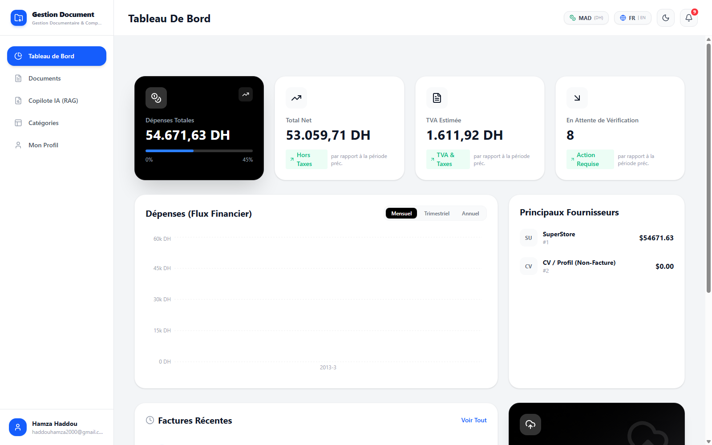
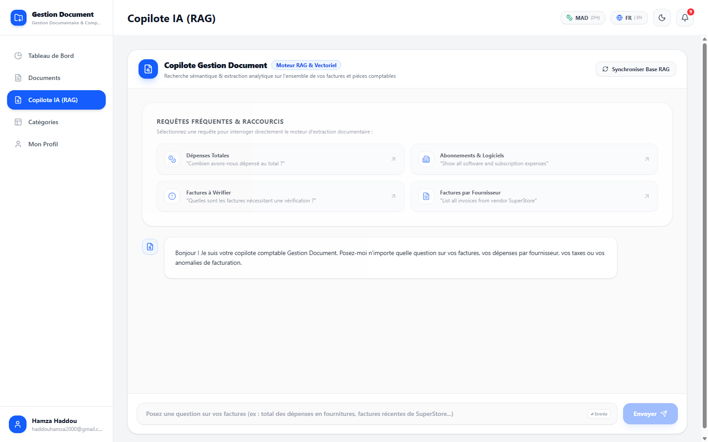
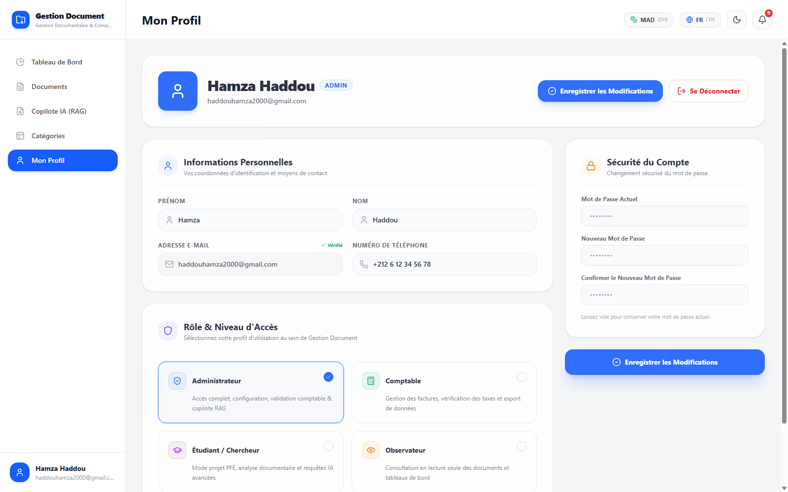
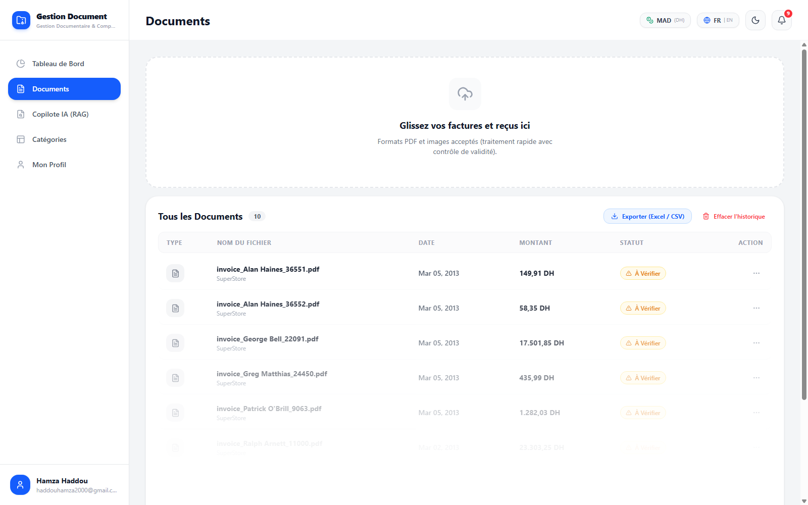
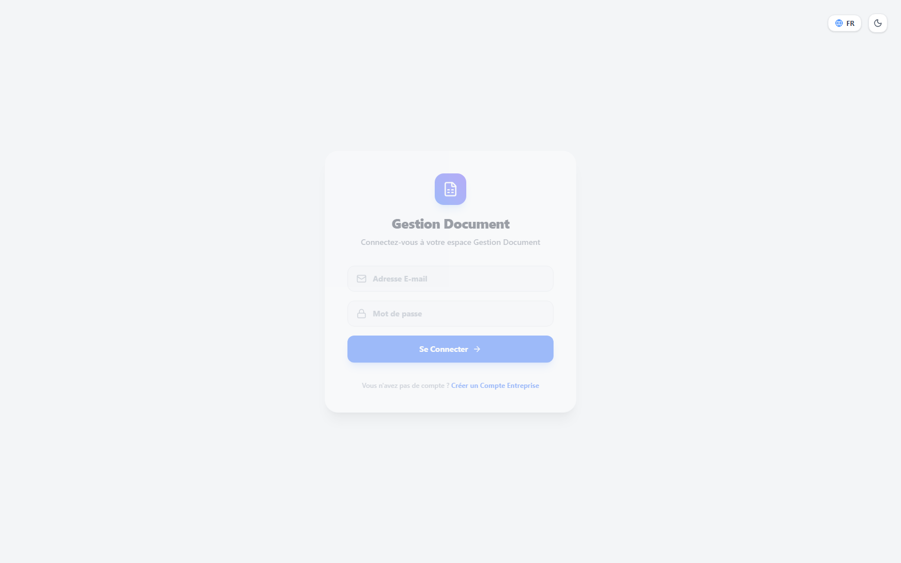

# Gestion Document 📄⚖️
### *Plateforme Intelligente d'Automatisation Comptable & Gestion Documentaire*
> **Master PFE Project & Production-Grade Accounting SaaS**  
> **Author & Architect**: [Hamza Haddou](mailto:haddouhamza2000@gmail.com) | *Octobre 2026*

<p align="center">
  
  
  
  
  
  
  
  
</p>

---

## 📌 Aperçu du Projet (Executive Summary)

**Gestion Document** est une plateforme SaaS complète de dématérialisation et d'automatisation des écritures comptables pour les PME et cabinets d'expertise comptable marocains et internationaux.

Conçue selon le paradigme **Human-in-the-Loop AI**, elle combine :
- Un **pipeline d'extraction hybride ultra-rapide (<1s)** alliant OCR Tesseract, analyse spatiale de mise en page (*Layout Spatial Heuristics*) et expressions régulières contextuelles à frontières strictes (`\b`).
- Un **moteur RAG (Retrieval-Augmented Generation)** pour interroger l'ensemble de la base documentaire en langage naturel (français & anglais) avec citations et scores de pertinence.
- Un **moteur de calcul de TVA marocaine** (20%, 14%, 10%, 7%, 0%), une gestion multi-devises native (**MAD / DH**, **EUR €**, **USD $**), et une **piste d'audit légale** en 6 étapes horodatées.

---

## 📸 Galerie & Démonstration de l'Interface

### 1. Tableau de Bord Financier & Indicateurs Clés
> Suivi en temps réel des dépenses, flux de trésorerie, ventilation par fournisseur et alertes sur les pièces nécessitant validation.
<p align="center">
  
</p>

---

### 2. Copilote Comptable RAG (Recherche Sémantique Vectorielle)
> Assistant conversationnel intelligent interrogeant l'ensemble des passages OCR indexés pour répondre instantanément sur les dépenses, fournisseurs et anomalies fiscales.
<p align="center">
  
</p>

---

### 3. Profil Utilisateur & Contrôle d'Accès Basé sur les Rôles (RBAC)
> Gestion des identités, rôles (Administrateur, Comptable, Étudiant / Chercheur, Observateur) et sécurité du compte.
<p align="center">
  
</p>

---

### 4. Gestion des Documents & Ingestion Hybride
> Vue synthétique des factures téléversées, statuts de traitement asynchrones, montants et ventilation analytique.
<p align="center">
  
</p>

---

### 5. Portail d'Authentification Sécurisé
> Authentification par jetons JWT Bearer avec hachage PBKDF2 et isolation des données.
<p align="center">
  
</p>

---

## 🏗️ Architecture Technique & Système

```text
                               ┌────────────────────────────────────────────────────────┐
                               │                    FRONTEND REACT 19                   │
                               │  Vite 7 • Tailwind CSS v4 • Lucide • Framer Motion     │
                               └───────────────────────────┬────────────────────────────┘
                                                           │ HTTP / JWT Bearer
                                                           ▼
                               ┌────────────────────────────────────────────────────────┐
                               │                   FASTAPI REST API                     │
                               │  Upload • Auth (PBKDF2) • Verification • RAG Search    │
                               └──────────────┬──────────────────────────┬──────────────┘
                                              │                          │
                 Background Huey Tasks        │                          │ SQLAlchemy ORM
                                              ▼                          ▼
                   ┌───────────────────────────────────┐    ┌───────────────────────────┐
                   │        HUEY ASYNC WORKER          │    │       POSTGRESQL 16       │
                   │  Tesseract 5 OCR • Regex Engine   │    │  (ou SQLite local .db)    │
                   │  Classification • Layout Analysis │    │  Users, Docs & Chunks     │
                   └──────────────────┬────────────────┘    └───────────────────────────┘
                                      │
                                      ▼
                   ┌───────────────────────────────────┐
                   │         RAG VECTOR STORE          │
                   │   Semantic Document Embeddings    │
                   │   Cosine Similarity Retrieval     │
                   └───────────────────────────────────┘
```

---

## ✨ Fonctionnalités Majeures

### 1. Ingestion Documentaire & Extraction Hybride
- **Extraction financière instantanée** : Montant Total (TTC), Montant Hors Taxes (HT), Taux et Montant de TVA, Date de facturation, Numéro de facture, Nom du fournisseur.
- **Classification préventive anti-faux positifs** : Détection immédiate des CVs, notes et fichiers non comptables via frontières lexicales `\b`, immédiatement classés en `Rejected` avec un score de confiance de 95%.
- **Vitesse d'exécution** : Traitement d'une facture en **moins d'une seconde** en local sur CPU sans dépendance cloud coûteuse.

### 2. Fiche Comptable & Piste d'Audit Légale (Human-in-the-Loop)
- **Calculs et déductions automatiques** :
  - `Calculer TTC = HT + TVA`
  - `Déduire HT depuis TTC`
- **Piste d'audit en 6 étapes** :
  1. *Ingestion Horodatée* (Date, heure, SHA et métadonnées brutes).
  2. *OCR Engine Tesseract 5* (Extraction textuelle exhaustive).
  3. *Classification Sémantique* (Détection automatique du type de pièce).
  4. *Extraction Hybride* (Ancrage spatial et regex de conformité).
  5. *Indexation Vectorielle RAG* (Découpage en chunks sémantiques).
  6. *Supervision & Validation Humaine* (Validation finale par le comptable).

### 3. Moteur Multi-Devises & Spécificités Marocaines
- Prise en charge native du **Dirham marocain (MAD / DH)** par défaut, de l'**Euro (EUR €)** et du **Dollar US (USD $)**.
- Formats monétaires professionnels conformes aux règles comptables (ex: `1 450,00 DH`).

### 4. Exportation Comptable Multi-Format
- **Excel multi-feuilles (.xlsx)** prêt pour le logiciel de tenue comptable.
- **CSV (.csv)** standard avec séparateurs point-virgule/virgule.
- **JSON (.json)** pour les intégrations API et ERP.

---

## 🛠️ Stack Technologique

| Domaine | Technologies |
| :--- | :--- |
| **Backend API** | Python 3.12+, FastAPI, Pydantic v2, Uvicorn |
| **Base de Données** | PostgreSQL 16 (Production / Docker), SQLite (Local), SQLAlchemy ORM |
| **Traitement Asynchrone** | Huey Task Queue (multi-workers non-bloquants) |
| **OCR & NLP** | Tesseract OCR 5 (`pytesseract`), PyPDF2, pdf2image |
| **Moteur Sémantique RAG** | Scikit-learn (TF-IDF vectorizer, Cosine similarity), Sentence Chunker |
| **Sécurité & Auth** | JWT Bearer Tokens, Passlib PBKDF2 password hashing |
| **Frontend** | React 19, Vite 7, Tailwind CSS v4, Lucide React, Framer Motion, Recharts |
| **DevOps & Déploiement** | Docker, Docker Compose multi-services |

---

## 🚀 Installation & Démarrage

### Option 1 : Démarrage avec Docker Compose (Recommandé en Production)
Démarre automatiquement PostgreSQL, l'API FastAPI, le worker Huey et le frontend Vite :
```bash
docker-compose up -d
```
- **Application Web** : `http://localhost:5173`
- **Documentation API Interactive (Swagger)** : `http://127.0.0.1:8000/docs`

---

### Option 2 : Démarrage Local (Windows - Script en 1 Clic)
Double-cliquez sur le fichier racine :
```cmd
start_project.bat
```
Ce script active l'environnement virtuel et lance dans des fenêtres dédiées :
1. Le serveur FastAPI (`http://127.0.0.1:8000`)
2. Le worker asynchrone Huey
3. Le serveur de développement Vite (`http://localhost:5173`)

---

### Option 3 : Démarrage Manuel

#### Backend :
```bash
# 1. Activer l'environnement virtuel
.venv\Scripts\activate

# 2. Installer les dépendances
cd backend
pip install -r requirements.txt

# 3. Lancer l'API
uvicorn main:app --reload --port 8000

# 4. Dans un second terminal, lancer le worker Huey
python -m huey.bin.huey_consumer tasks.huey -w 2
```

#### Frontend :
```bash
cd frontend
npm install
npm run dev
```

---

## 👨‍💻 Auteur & Informations Académiques

* **Auteur** : **Hamza Haddou**
* **Contact** : [haddouhamza2000@gmail.com](mailto:haddouhamza2000@gmail.com)
* **Cadre** : Projet de Fin d'Études (Master PFE Maroc) — *Système d'automatisation documentaire et comptable par Intelligence Artificielle*.
* **Licence** : Distribué sous licence **MIT**.
